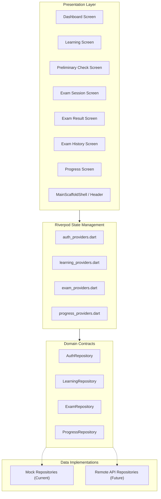

# Backend Integration Readiness Specification

This document details the complete backend integration architecture for the Powerdrive Learning mobile app. It defines all domain contracts, data models, suggested API endpoints, and unresolved business rules required when replacing mock repositories with live production services.

---

## 1. Repository Interfaces & Model Dependencies

The application architecture enforces strict dependency inversion: UI widgets and Riverpod notifiers communicate exclusively with abstract repository interfaces rather than mock implementations.



### Repository Mapping Table

| Repository Interface | Model Types Used | Primary Consuming Providers / Screens | Suggested Future API Endpoints |
| :--- | :--- | :--- | :--- |
| `AuthRepository` | `User` | `currentUserProvider`, `AppHeader`, `MainScaffoldShell` | `GET /api/v1/auth/me`<br>`POST /api/v1/auth/login`<br>`POST /api/v1/auth/logout`<br>`PATCH /api/v1/user/language` |
| `LearningRepository` | `DrivingClass`, `LearningUnit`, `Question`, `QuestionProgress` | `drivingClassesProvider`, `learningUnitsProvider`, `LearningScreen`, `QuestionDetailScreen` | `GET /api/v1/classes`<br>`GET /api/v1/learning-units?class={code}`<br>`GET /api/v1/questions/{number}`<br>`POST /api/v1/questions/{id}/progress` |
| `ExamRepository` | `DrivingClass`, `Question`, `ExamAttempt` | `eligibleExamClassesProvider`, `examHistoryProvider`, `totalExamsCountProvider`, `examSessionProvider`, `PreliminaryCheckScreen`, `ExamSessionScreen`, `ExamResultScreen`, `ExamHistoryScreen` | `GET /api/v1/exams/preliminary/classes`<br>`POST /api/v1/exams/preliminary/session`<br>`POST /api/v1/exams/preliminary/{id}/submit`<br>`GET /api/v1/exams/preliminary/history` |
| `ProgressRepository` | `LearningProgress`, `TopicProgress` | `learningProgressProvider`, `DashboardScreen`, `ProgressScreen` | `GET /api/v1/progress/learning`<br>`GET /api/v1/progress/topics` |

---

## 2. Screen Data Requirements & Missing Contracts

### A. Dashboard (`DashboardScreen`)
- **Required Data:**
  - Authenticated user name and current session status.
  - Question counts for Box 0 and Subjects 1–3.
  - Active driving class eligibility for preliminary check and practice exams.
- **Missing Backend Contracts:**
  - Live session validation token / cookie format.
  - Dynamic user notification / learning tip feed endpoint.

### B. Learning Module (`LearningScreen` & `QuestionDetailScreen`)
- **Required Data:**
  - Available driving classes (e.g. `GW`, `B`, and any future vehicle categories like `A`, `C`, `E`).
  - Learning units grouped by category with total questions, exam-ready count, and box breakdown (Box 0..3).
  - Individual question lookup by numeric ID (e.g. `#1278`), including question stem, answer choices, and associated road sign / situation imagery.
- **Missing Backend Contracts:**
  - Full catalog search / pagination endpoints.
  - Answer verification contract (whether client submits answer choice and receives immediate feedback or records Leitner box transition silently).

### C. Preliminary Check Selection (`PreliminaryCheckScreen`)
- **Required Data:**
  - Eligible classes for preliminary exams (`GW`, `B`) and their respective official question quotas ($40$ each).
  - Dynamic question calculation rules for multi-class selection.
- **Missing Backend Contracts:**
  - Combined examination policy (whether selecting GW + B creates one combined 80-question test or two sequential sessions).

### D. Examination Runner (`ExamSessionScreen` & `ExamResultScreen`)
- **Required Data:**
  - Server-randomized question payload for the selected class codes.
  - Server-calculated score, pass/fail result, and question-level review breakdown upon submission.
- **Missing Backend Contracts:**
  - Exact time limits per question or per examination session.
  - Official passing criteria (e.g. $80\%$ vs. $90\%$ points threshold).
  - Bonus question scoring logic and weighting formulas.

### E. Examination History (`ExamHistoryScreen`)
- **Required Data:**
  - Historical attempt log: attempt ID, timestamp, classes taken, points scored, total questions, percentage, and pass/fail status.
  - Total exams counter.
- **Missing Backend Contracts:**
  - Pagination for long attempt histories.
  - Historical review payload (whether learners can re-open an attempt to inspect missed questions).

### F. Progress Dashboard (`ProgressScreen`)
- **Required Data:**
  - Total answered questions counter.
  - Current milestone rank/level (`Beginner 🐣`, etc.).
  - Leitner distribution percentages (`Fach 0` – `Fach 3`).
  - Topic progress list with progress bars and exam-ready numbers.
- **Missing Backend Contracts:**
  - Mathematical definition of Fach percentages.
  - Level milestone thresholds.

---

## 3. Production Readiness Specifications

### A. Authentication & Session Handling
- The future production authentication repository (`RemoteAuthRepository`) should implement secure token storage (e.g. using `flutter_secure_storage`) rather than plain `SharedPreferences`.
- All requests should include `Authorization: Bearer <token>` or session cookies matching the web platform's authentication scheme.
- HTTP 401 Unauthorized errors should automatically invalidate `currentUserProvider` and prompt re-login.

### B. Network Error Handling & Offline Strategy
- Repository implementations must map low-level transport errors (socket exceptions, timeouts, non-2xx status codes) into typed domain exceptions (`NetworkException`, `ServerException`, `NotFoundException`).
- Examination taking should store answers in temporary in-memory session state so transient drops do not abort active tests.

### C. Question Media & Diagram Assets
- Question models support `mediaUrl` (nullable).
- In production, SVG or WebP diagram assets should be loaded via cached network image providers with placeholder fallbacks matching the existing road situation placeholder design.

---

## 4. Swapping from Mock to Production

Switching the entire application from mock to live API will require **zero changes to presentation widgets**:
```dart
// In main.dart or bootstrap:
void main() {
  runApp(
    ProviderScope(
      overrides: [
        authRepositoryProvider.overrideWithValue(RemoteAuthRepository(apiClient)),
        learningRepositoryProvider.overrideWithValue(RemoteLearningRepository(apiClient)),
        examRepositoryProvider.overrideWithValue(RemoteExamRepository(apiClient)),
        progressRepositoryProvider.overrideWithValue(RemoteProgressRepository(apiClient)),
      ],
      child: const PowerdriveApp(),
    ),
  );
}
```
