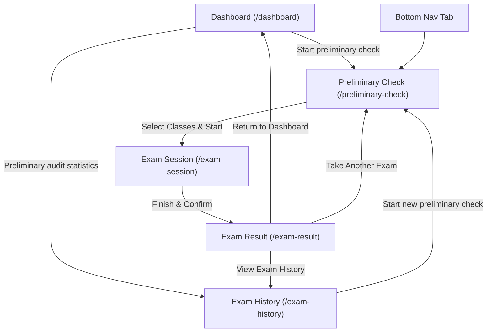

# Phase 5 — Preliminary Check, Mock Exam Flow & Exam History

This document details the architectural structure, navigation lifecycle, mock scoring rules, and backend integration requirements implemented in Phase 5 of the Powerdrive Learning mobile app.

---

## 1. Implemented Screens

### A. Preliminary Check Screen (`PreliminaryCheckScreen`)
- **Route:** `/preliminary-check` (also accessible via bottom navigation and dashboard shortcut).
- **Header:** Powerdrive brand app bar with language selection.
- **Class Selection Cards:**
  - Class `GW` (Grundwissen) — 40 questions configured.
  - Class `B` (Klasse B) — 40 questions configured.
  - Visual states: active selected state with royal blue highlight, subtle fill, and checkmark; unselected state with neutral border.
- **Dynamic Calculation Card:**
  - Instantly computes `Total: X questions including bonus questions`.
  - Explanatory footnote on unverified combined examination rules.
- **Action Button:** "Start preliminary check", enabled dynamically only when $\ge 1$ class is selected.

### B. Mock Examination Screen (`ExamSessionScreen`)
- **Route:** `/exam-session` (root navigator).
- **Navigation Controls:**
  - Close button with safe exit confirmation dialog (`Exit Examination?`).
  - Top "Finish" action button.
- **Session Progress Bar:** Linear progress indicator indicating `(currentIndex + 1) / totalQuestions`.
- **Question Card:**
  - Driving class indicator badge (e.g. `Class GW`).
  - Question counter: `Question X of Y`.
  - Official question number badge (e.g. `#1278`).
  - High-contrast question text.
  - Diagram / illustration placeholder for Austrian traffic scenarios.
- **Answer Selection:**
  - Interactive radio/card selection.
  - Preserves selected answers across previous/next navigation.
- **Navigation Action Bar:**
  - "Previous" button (disabled on question 0).
  - "Next" button (advances within bounds).
  - On the final question, transforms into "Finish Assessment" with confirmation dialog showing answered vs. unanswered counts.

### C. Mock Examination Result Screen (`ExamResultScreen`)
- **Route:** `/exam-result` (root navigator).
- **Result Metrics:**
  - Demonstration score percentage (e.g. `80%`).
  - Correct answers vs. total questions ratio.
  - Classes evaluated.
- **Clear Demonstration Tag:**
  - `DEMONSTRATION ASSESSMENT ONLY` disclaimer.
  - Label: `Bestanden (Demo)` or `Nicht bestanden (Demo)`.
- **Actions:**
  - "Return to Dashboard" (`/dashboard`)
  - "View Exam History" (`/exam-history`)
  - "Start Another Preliminary Check" (`/preliminary-check`)
- **Pop Safety:** Intercepts Android back-button to navigate to `/preliminary-check` safely without re-entering completed exam sessions.

### D. Preliminary Audit Statistics / Exam History (`ExamHistoryScreen`)
- **Route:** `/exam-history`.
- **Title:** `Your preliminary exams`.
- **Summary Stat Card:** Total preliminary exams count and "Start new preliminary check" button.
- **Performance Trend Chart:**
  - Built with `fl_chart`.
  - Plots chronological score percentage curve ($0$–$100\%$) across historical attempts.
- **Past Attempts List:**
  - Responsive cards with class badges (`GW`, `B`).
  - Date and time formatted with `intl` (`dd.MM.yyyy, HH:mm`).
  - Score formatted as `0% (0/40)`.
  - Status badge: `Nicht bestanden` / `Bestanden (Demo)`.
- **Empty State:** Clean placeholder when no exams have been taken.

---

## 2. Navigation and Session Flow

---

## 3. Mock Question Structure & Scoring Policy

### Question Bank
10 Austrian driving theory questions matching Austrian traffic rules:
- **GW:** Speed limit on country roads outside built-up areas (100 km/h), Tunnel safety & red signals, Rettungsgasse (emergency corridor), Flashing green light meaning, Horn usage restrictions in built-up areas.
- **B:** Minimum summer tire tread depth (1.6 mm), Minimum winter radial tire tread depth (4.0 mm), Speed doubling quadruples braking distance, Required driver documents (License + Zulassungsschein), Protruding load marker board rules.

### Deterministic Demo Scoring Policy (`MockAssessmentService`)
- Evaluates selected answers against `QuestionAnswerOption.isCorrect`.
- Percentage calculated as `(correctCount / totalQuestions) * 100`.
- Demonstration passing threshold is set at $80\%$ purely for visual prototyping.
- Attempt is saved immediately to `ExamRepository` and refreshes `examHistoryProvider`.

---

## 4. Unverified Production Rules & Backend Integration Requirements

When connecting to the live Powerdrive backend, the following aspects require verification and configuration:
1. **API Endpoints:**
   - Preliminary exam initiation endpoint (`POST /api/exams/preliminary/start`).
   - Question payload format and media assets / diagrams.
   - Answer submission endpoint (`POST /api/exams/preliminary/:id/submit`).
   - Historical attempts endpoint (`GET /api/exams/preliminary/history`).
2. **Scoring & Pass Rules:**
   - Exact passing score threshold on the website.
   - Question point weightings (e.g. 2-point, 4-point, or bonus questions).
   - Negative scoring or sub-question dependencies.
3. **Combined Exam Logic:**
   - Whether GW and B are taken jointly (80 questions) or strictly separated into individual checks.
